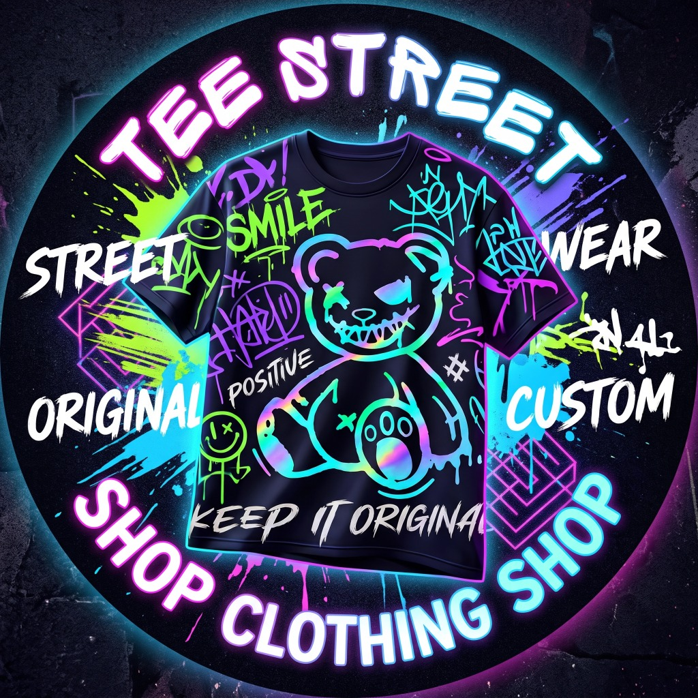

# TEE STREET // Cyberpunk & Oversize Streetwear Store

Полнофункциональный современный интернет-магазин оверсайз-футболок и киберпанк-мерча нового поколения.



## Технологический стек

- **Frontend**: React 19, TypeScript, Tailwind CSS v4, Vite 6
- **Иконки**: Lucide React (строго векторные SVG без системных эмодзи)
- **3D & Интерактив**: Интерактивный 360-градусный 3D-осмотр футболок с зумом до 3.5x, пресетами ракурсов и примеркой 6 цветов ткани в реальном времени
- **Медиа**: HD видео-витрина в шапке (2.6 МБ, slow-mo 0.5x, луп)
- **Магазин & Функционал**:
  - Каталог с фильтрацией по категориям (Оверсайз, Стритвир, Киберпанк, Лимитированные дропы, Аниме / Меха)
  - Выбор размеров (S, M, L, XL, XXL) с таблицей параметров (грудь, длина, рост)
  - Корзина с промокодами (`DROP2026` на 15%, `FREAK` на 20%) и подсчетом скидок
  - Избранное (Wishlist) с быстрым переносом в корзину
  - Оформление заказа: доставка СДЭК, Яндекс Доставка, Почта России, курьер, либо самовывоз из флагманских шоурумов TEE STREET (Москва, СПб, Казань, Екатеринбург)
  - Оплата через СБП (Система быстрых платежей) с QR-кодом и проверкой транзакции, либо при получении
  - Профиль покупателя со списком заказов, онлайн-трекингом статуса доставки и оформлением возврата
  - Админ-панель (скрыта на мобильных устройствах): управление товарами (добавление, редактирование, удаление, модерация), изменение статусов заказов, аналитика и статистика продаж

---

## Деплой на Vercel

1. Импортируйте репозиторий в [Vercel](https://vercel.com/new).
2. Настройки по умолчанию подхватятся автоматически из `vercel.json`:
   - **Framework Preset**: Vite
   - **Build Command**: `cd frontend && npm install && npm run build`
   - **Output Directory**: `frontend/dist`
3. Нажмите **Deploy** — через минуту сайт будет опубликован в интернете!

*(Если при импорте вы указываете **Root Directory = `frontend`**, Vercel также соберет проект автоматически).*

---

## Локальный запуск

```bash
# Клонирование репозитория
git clone https://github.com/PKSic/tee-street.git
cd tee-street

# Запуск фронтенда
cd frontend
npm install
npm run dev
```

Сайт откроется по адресу `http://localhost:5173`.

---

## Автор и лицензия

- **Автор**: [PKSic](https://github.com/PKSic)
- **Лицензия**: MIT
